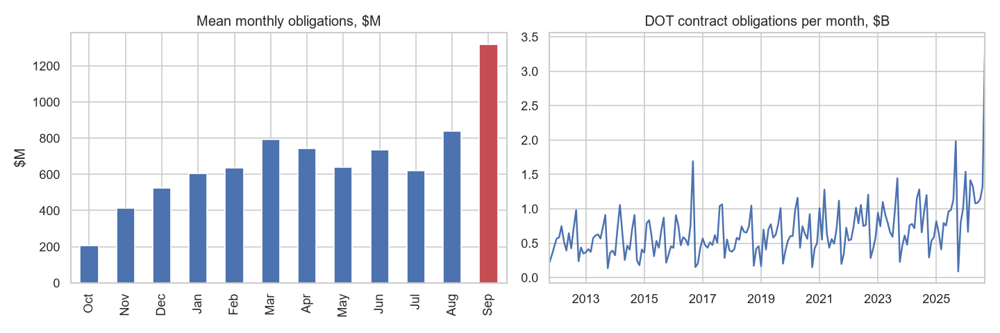
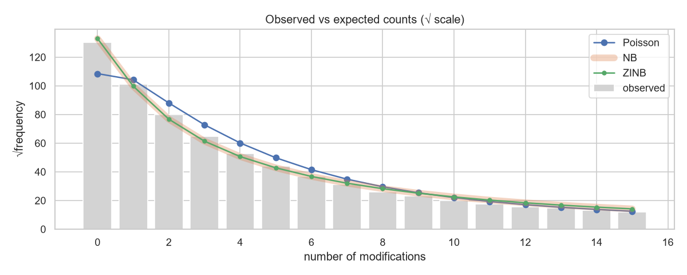
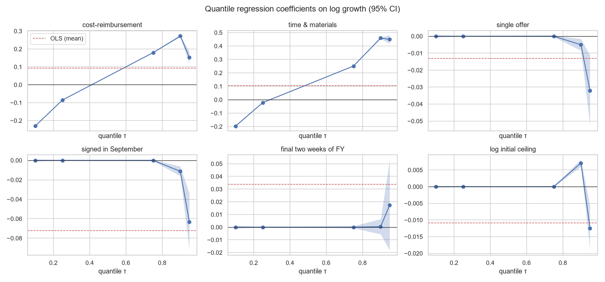
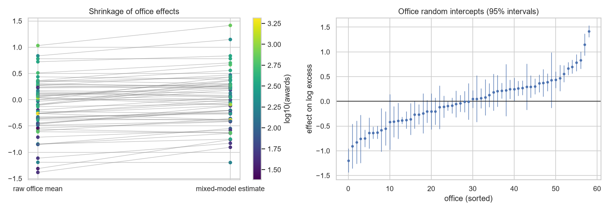
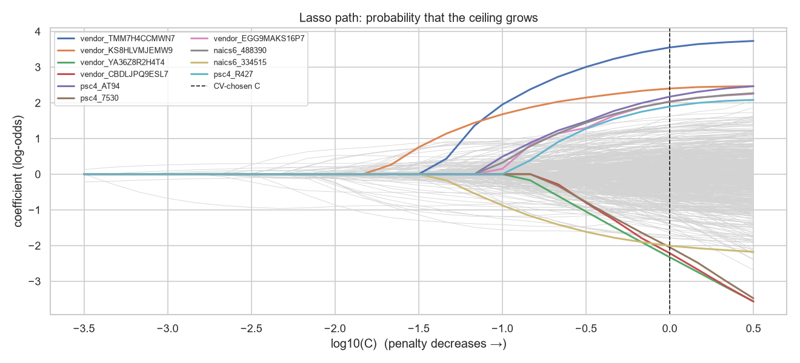
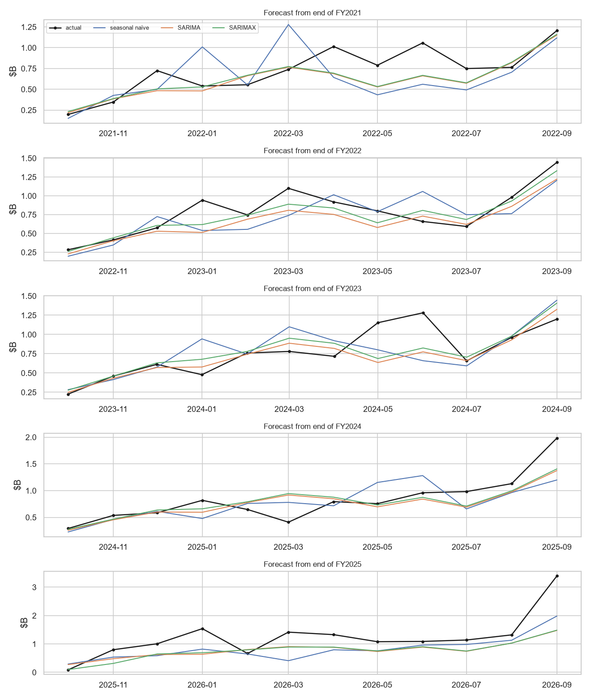
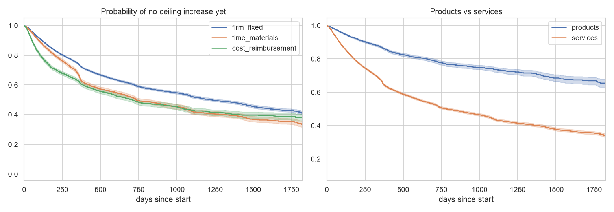

# What happens to a federal contract after it's signed?

**Advanced regression on 60,613 Department of Transportation contracts, FY2013-FY2026**

Every federal contract action is public. This project follows DOT contracts (FAA, FHWA, MARAD and the rest of the
department) from signing until the end of FY2026, and models how they change afterwards:

- how often they are **modified** (count models),
- how much their **ceiling grows** (two-part GLM, quantile regression),
- whether some **contracting offices** run systematically hotter (mixed-effects models),
- which detailed features predict growth, and **which contracts were cut** in the FY2025 termination wave
  (regularized regression),
- what the department will **obligate next year** (seasonal time-series regression),
- how soon the **first cost increase** arrives (survival analysis),
- and how much accuracy all of this gives up against **gradient boosting** (LightGBM + SHAP).

Each question uses the model its data calls for. Each model's assumptions are tested, and results that went against
expectations are reported rather than hidden.

---

## Contents

1. [Findings in one page](#findings-in-one-page)
2. [Why this question](#why-this-question)
3. [Data](#data)
4. [Analysis walkthrough](#analysis-walkthrough)
   [02 Counts](#02--how-often-is-a-contract-modified) ·
   [03 Growth](#03--how-much-does-the-ceiling-grow) ·
   [04 Offices](#04--do-some-contracting-offices-run-hotter) ·
   [05 Regularization](#05--regularized-regression) ·
   [06 Forecasting](#06--forecasting-monthly-obligations) ·
   [07 Survival](#07--how-soon-does-the-first-cost-increase-arrive) ·
   [08 GBM](#08--how-much-do-the-glms-give-up)
5. [Modeling decisions I'd defend](#modeling-decisions-id-defend)
6. [Questions to be ready for](#questions-to-be-ready-for)
7. [Concepts cheat-sheet](#concepts-cheat-sheet)
8. [Limitations and next steps](#limitations-and-next-steps)
9. [Reproduce](#reproduce)

---

## Findings in one page

1. **The type of work predicts trouble better than how the contract is priced.** Services have 2.4-8× the odds of
   ceiling growth of products (education/training is the mild exception at 1.5×), and reach their first increase
   1.3-3.4× faster. Cost-reimbursement contracts look risky in raw data (38% grow vs 24% for firm-fixed-price). Once
   the type of work and the contracting office are controlled for, that gap disappears or reverses.
2. **Time-and-materials is the exception.** It stays risky under every adjustment: 55% more modifications per
   planned year, 30% higher odds of growth, larger growth when it happens, first increase ~30% sooner. The
   effect is concentrated in the tail. At the 90th percentile of growth it is ×1.58, against ×1.11 at the mean.
3. **The September rush does not produce worse contracts.** 16.3% of annual obligations land in September (twice an
   even share). Yet September awards are slightly *less* likely to grow and are the slowest to need more money
   (hazard ratio 0.82). The only rush effect is +7% more modifications for awards signed in the final two weeks.
4. **Contracting offices matter, and part of the "contract type" effect is really an office effect.** About 9% of the
   unexplained variation in growth sits between offices. After adjusting for office, the non-competed
   penalty almost vanishes and the cost-reimbursement coefficient halves.
5. **Modification counts are negative binomial: not Poisson, and not zero-inflated.** The variance is 5.7× what
   Poisson allows. NB reproduces the third of awards never modified without a separate zero process.
6. **The FY2025 termination wave was predictable from award-time features** (nested-CV AUC 0.82). Education/training
   and research contracts were cut at 2-6× the FAA's rate. Pricing type made no difference.
7. **Forecasting: shutdowns cut a month's obligations by ~63%,** and SARIMAX beats seasonal-naive month by month.
   Then FY2026 obligations jumped 50% on FAA air traffic control equipment, and every model missed by ~35%.
8. **The GLMs give up a little accuracy, and better features recover most of it.** LightGBM gains ~4 AUC points
   over the coarse logistic GLM. A lasso with detailed codes gets within 0.5 points while staying interpretable.

---

## Why this question

The questions are the ones a program office or cost analyst asks about a contract portfolio: which awards will
need more money, how much, how soon, and how much will we obligate next year. The data has the structure that makes
advanced regression necessary rather than optional:

| Feature of the data | Why ordinary regression fails | What this project uses |
|---|---|---|
| Outcomes are **counts** with huge variance | OLS predicts negative counts. Poisson understates uncertainty. | Negative binomial GLM with exposure offset |
| Growth has a **spike at "no change"** and long tails | No single distribution fits | Two-part (hurdle) model, quantile regression |
| Awards are **clustered** in ~70 offices | Correlated errors, overconfident standard errors | Mixed-effects models |
| **Hundreds of detailed codes** (products, industries, vendors) | Unstable, overfit coefficients | Ridge / lasso / elastic net |
| Spending is **seasonal** with shocks (shutdowns) | Autocorrelated residuals | SARIMAX with intervention regressors |
| Many contracts are still **running** (censored) | Dropping or zero-filling them biases timing | Survival models (Cox, AFT, competing risks) |

It is also operational, federal and supply-chain data: what an analyst supporting a federal program would work with.

---

## Data

**Source.** [USAspending.gov](https://www.usaspending.gov/) award data archive, "Contracts Full" files for agency 069
(DOT). These are the FPDS records agencies are required to report: one row per contract action (the base award and
every modification). FY2012-FY2026, **448,246 transactions**, 40 of ~300 columns kept.

**Unit of analysis: the award.** Definitive contracts, delivery/task orders, purchase orders and BPA calls whose base
action (modification 0) was signed in FY2013-FY2023 with an initial ceiling of at least $25,000. That gives
**60,613 awards** with at least three years of follow-up (to 30 Sep 2026). Indefinite-delivery *vehicles* are
excluded, but the orders placed against them are included.

**Outcomes, rebuilt from each award's full transaction history:**

| Outcome | Definition |
|---|---|
| `n_mods` | Number of modifications after the base award |
| `growth_ratio` | Final ceiling ÷ initial ceiling, where ceiling = base and all options value and final = initial + every modification's change |
| `any_growth` | Growth ratio > 1 |
| Time to first increase | Days from start of performance to the first modification adding at least 1% of the initial ceiling, censored at end of performance or 30 Sep 2026 |
| `terminated` | Any termination (convenience, default, cause) or legal cancellation |

**Features, all known at signing:** initial ceiling, planned length (with options), pricing type (firm-fixed-price,
time-and-materials, cost-reimbursement, other fixed), competition (full and open, set-aside, simplified, not
competed), number of offers and a single-offer flag, small business, commercial item, performance-based,
award type, product/service group, sub-agency, solicitation-to-award days, September and final-two-weeks flags,
cohort year. Notebook 05 adds 4-character product/service codes, 6-digit NAICS, contracting office and vendor.

**Data problems found and handled** (good interview material, because real data work is mostly this):

- **Award totals on transaction rows are snapshots.** Only 84% matched the sum of their transactions within a single
  year's file, because later modifications sit in later files. Ceilings are therefore rebuilt from the full
  15-year history.
- **Award type codes changed in FY2016** ("DO" → "DELIVERY ORDER", "DCA" → "DEFINITIVE CONTRACT", ...). They are
  normalized, otherwise the model would read a coding change as a real effect.
- **Office codes changed around FY2016** (legacy 5-digit → `69xxxx`). This is noted as a limitation in the mixed models.
- **Mistyped ceilings.** A few initial ceilings are clearly wrong (one reads $20 billion). Growth ratios are capped at
  the 99.5th percentile (20×) for mean models. Quantile regression, which is robust to them, uses raw values.
- **FY2025 termination spike** (418 vs a typical 50-100). It confounds any general termination model, so it is
  studied separately instead of being pooled.

---

## Analysis walkthrough

Each section follows the same pattern: **question → why this model → what was checked → results → what it means.**

### 01 · Exploration

[Notebook](notebooks/01_eda.ipynb). The shape of each outcome decided the model family:

- Modifications: mean 3.06, **variance 54**, 34.7% zeros → overdispersed counts.
- Growth ratio: **53% exactly 1**, 20% shrank, 27% grew, long right tail → mixture of regimes.
- First increase: 28.4% have one within their window. The rest are censored.
- Obligations: **16.3% in September**, against 8.3% for an even spread. The fiscal-year-end rush is real.



### 02 · How often is a contract modified?

[Notebook](notebooks/02_modification_counts.ipynb)

**Model.** Count GLM with log link and an **exposure offset** of log(planned years). A 5-year contract has more chances
to be modified than a 3-month one, so the model works with the rate per planned year. Planned length is fixed at
signing, so it can't be contaminated by the outcome. The same variable is also a covariate, which lets the data decide
whether the count scales in proportion to length. It doesn't: the covariate's coefficient is −0.80, so the total
elasticity is about 0.2. A contract planned to run twice as long gets only ~15% more modifications (2^0.2).

**Sequence and checks:**

| Step | Result | Conclusion |
|---|---|---|
| Poisson | Pearson χ²/df = **5.72** (should be ≈ 1) | Variance far above mean. SEs understated by ~√5.7 ≈ 2.4× |
| Cameron-Trivedi test | α̂ = 0.97, t = 11.9 | Variance grows with μ² → NB2 form |
| Negative binomial (NB2) | α̂ = 0.757. LR χ² = 70,222. AIC 254,539 → **184,319**. Pearson χ²/df = 1.99 | NB is far better |
| Zeros | Observed 16,949. Poisson expects 11,765. **NB expects 17,656** | NB already explains the zeros |
| Zero-inflated NB | Structural-zero share **0.0%**. AIC/BIC worse than NB | No separate "never touched" population |
| Influence | Refit without the top 0.1% by Cook's distance → rate ratios move by < 0.04 | Not driven by outliers |
| Out-of-time test (FY2022-23) | Predicted 3.30 vs observed 2.86 | Over-predicts ~15%. Younger cohorts have shorter follow-up |



**Results (rate ratios from NB, holding everything else fixed):**

| Feature | Rate ratio | Reading |
|---|---|---|
| Time-and-materials (vs firm-fixed-price) | **1.55** | 55% more modifications per planned year |
| Simplified acquisition (vs full and open) | 1.47 | |
| Definitive contract (vs delivery order) | 1.38 | |
| Log initial ceiling | 1.43 per log-dollar | Bigger awards are modified more |
| Single offer | 1.14 | Competed, but only one bidder |
| Cost-reimbursement | 1.14 | |
| Signed in September | 0.93 | Slightly *fewer* |
| Final two weeks of FY (on top of September) | 1.08 | The only rush penalty |
| Purchase order | 0.68 | Simple buys, rarely touched |

**What it means.** Overdispersion is the headline methodological point: a Poisson model would have declared almost
everything significant. The zero-inflation result is a useful lesson. Lots of zeros do not automatically mean a
zero-inflated process; often the overdispersion explains them.

### 03 · How much does the ceiling grow?

[Notebook](notebooks/03_ceiling_growth.ipynb)

**Model.** Growth has three regimes (unchanged, shrank, grew), so it is split:

1. **Hurdle:** logistic regression for P(ceiling grows).
2. **Severity:** Gamma GLM with log link on excess growth (ratio − 1) for awards that grew.
3. **Tails:** quantile regression of log growth at τ = 0.10, 0.25, 0.75, 0.90, 0.95. The median is skipped because over
   half the values are exactly zero, which makes it degenerate.

**Checks:**

| Check | Result | Conclusion |
|---|---|---|
| VIF | Max 4.9 (solicitation-time pair). Rest < 3.6 | No harmful collinearity |
| Park test (log resid² on log μ) | Slope **2.09** (CI 2.06-2.13) | Variance ∝ μ², as Gamma assumes |
| Gamma vs log-normal (Jacobian-adjusted AIC) | 41,566 vs **33,960** | **Log-normal fits better.** Gamma's single shape parameter can't span growth from +0.1% to +1,900% |
| Breusch-Pagan on OLS of log growth | LM = 762, p ≈ 1e-128 | Heteroscedastic. The mean model misses part of the story → quantile regression |

**Why keep the Gamma anyway?** With a log link, a Gamma GLM is a **quasi-likelihood** estimator. Its coefficients are
consistent for E[excess | X] as long as the *mean* is correctly specified, even if the distribution is wrong. It was
refitted with robust (sandwich, HC0) standard errors. A log-normal needs a retransformation (smearing) correction to
say anything about mean dollars. This is a nuanced point and worth being able to explain.

**Results:**

| Feature | Hurdle: odds of growth | Severity: × excess growth |
|---|---|---|
| Time-and-materials | **1.30** | **1.12** |
| Cost-reimbursement | 0.91 | 0.95 (n.s.) |
| Not competed | 1.09 | 1.18 |
| Simplified acquisition | 1.30 | 0.76 |
| Log initial ceiling | 1.26 | 0.80 |
| September | 0.87 | 0.86 |
| Services vs products | 1.5 (education) to **8.0** (utilities/housekeeping). Architect-engineering 5.1, construction 3.2, IT 2.5 | |

Combining both parts (average predictive comparison), expected excess growth is 0.45 for firm-fixed-price,
**0.59 for time-and-materials (+32%)** and 0.40 for cost-reimbursement.

**Quantile regression: where pricing type matters** (multiplicative effect on growth ratio):

| | τ=0.10 | τ=0.25 | τ=0.75 | τ=0.90 | τ=0.95 | OLS mean |
|---|---|---|---|---|---|---|
| Time-and-materials | 0.82 | 0.98 | 1.29 | **1.58** | **1.57** | 1.11 |
| Cost-reimbursement | 0.79 | 0.92 | 1.20 | **1.31** | 1.16 | 1.10 |



**What it means.** Cost-type and T&M contracts aren't just higher on average. They are **more variable**: they
descope more at the bottom (0.8× at τ=0.10) and overrun more at the top (1.3-1.6× at τ=0.90). The mean (1.1×) hides
both. For a cost-risk reviewer, tail risk matters more than the average. Also note the reversal: cost-reimbursement
looks risky in raw data only because cost contracts buy riskier kinds of work.

### 04 · Do some contracting offices run hotter?

[Notebook](notebooks/04_office_effects_mixed.ipynb)

**Model.** Linear mixed model on log excess growth (awards that grew), with a **random intercept per contracting
office**, then a random slope for cost-type pricing. Offices with fewer than 20 grown awards are pooled (59 groups).
Fitted by maximum likelihood (not REML) so nested models can be compared by likelihood ratio. A binomial GLMM
(variational Bayes) does the same for the probability of growth.

**Results:**

| Quantity | Value | Reading |
|---|---|---|
| LR test: random intercept vs none | 1,176 (p ≈ 1e-258) | Office clustering is real |
| LR test: + random slope for cost-type | 178 (p ≈ 1e-39) | Offices differ in how cost-type pricing plays out |
| τ² (between offices) / σ² (residual) | 0.274 / 2.801 | |
| **ICC** | **0.089** | ~9% of unexplained variance is between offices |
| Office +1 SD | **~70% more excess growth** | exp(√0.274) = 1.69 |
| Intercept-slope covariance | −0.19 | High-growth offices see *less* extra growth from cost-type pricing |
| GLMM office SD (log-odds) | 0.55. ICC 0.084 | ±1 SD office = **3× odds** of growth |

**Fixed effects before vs after accounting for office (log scale):**

| | OLS | Mixed |
|---|---|---|
| Cost-reimbursement | 0.20 | **0.09** |
| Not competed | 0.21 | **0.05** |
| Time-and-materials | 0.30 | 0.22 |
| Single offer | 0.04 | **0.19** |
| September | −0.22 | −0.18 |



**What it means.** Offices that use cost-type and non-competed contracts more *also* run hotter for other reasons, so
part of those effects was really an office effect. Single-offer awards go the other way: within the same office they
are clearly worse. **Shrinkage** is the other key point. Small offices' estimates are pulled toward the mean in
proportion to how little data they have, so a ranking based on the mixed model doesn't put noisy small offices at
the extremes.

**Technical note.** The default L-BFGS optimizer diverged and reported τ² = 0. Powell and Nelder-Mead both converged
to the same non-zero optimum. Always sanity-check a variance component that lands exactly on the boundary.

### 05 · Regularized regression

[Notebook](notebooks/05_regularized.ipynb)

**Part A: which detailed features predict growth?** The design is expanded to 4-character product codes, 6-digit
NAICS, office and vendor: **727 sparse columns**. Logistic regression for P(growth) is fitted unpenalized and with
ridge (L2), lasso (L1) and elastic net, with penalty tuned by 5-fold CV, trained on FY2013-2021 and tested on
FY2022-23.

| Model | Test AUC | Test log loss | Non-zero coefficients |
|---|---|---|---|
| Unpenalized | 0.763 | 0.498 | 727 |
| Ridge | 0.766 | **0.492** | 727 |
| Lasso | **0.766** | 0.493 | **618** |
| Elastic net (l1_ratio 0.5) | 0.765 | 0.493 | 660 |
| *Coarse-feature logistic (notebook 08)* | *0.736* | *0.516* | ~40 |

- **Regularization helps a little; the detailed codes help more** (+3 AUC points). With 49k rows the unpenalized fit
  isn't badly overfit, so the honest conclusion is "modest gain", not "regularization saved the day".
- The **lasso path** shows what is robust. Size, pricing type, products vs services and planned length enter
  first. Individual vendors and 4-digit codes enter late.
- **Vendor identity is predictive.** The largest elastic-net coefficients belong to individual contractors. That is a
  practical signal a contracting officer could check at award time.
- Lasso vs ridge on correlated codes: lasso tends to keep one of a correlated pair (NAICS and product codes overlap);
  ridge spreads weight across both. Elastic net sits between them.
- *Tried and dropped:* predicting the **size** of growth as a continuous target. Every linear model had test R² < 0.01.
  How *much* a contract grows is barely predictable at signing. Whether it grows is.



**Part B: the FY2025 termination wave.** Population: 4,660 awards active on 1 Oct 2024. Outcome: terminated during
FY2025 (128, 2.75%). L1-logistic with the penalty tuned *inside* each outer fold (**nested CV**), scored by average
precision because the class is rare.

| Metric | Value |
|---|---|
| ROC AUC (out-of-fold) | **0.82** |
| Average precision | 0.157 = **5.7× the base rate** |
| Features kept | 105 of 146 |

| Group | Share cut |
|---|---|
| Education/training | **10.5%** |
| Research | 4.2% |
| Professional services | 3.1% |
| Products | 2.0% |
| Architect-engineering, equipment maintenance | 0% |
| Smaller administrations / Office of the Secretary | 11.7% / 6.2% |
| FAA | 1.8% |
| Firm-fixed / T&M / cost-reimbursement | 2.8% / 2.7% / 2.4% (no difference) |

### 06 · Forecasting monthly obligations

[Notebook](notebooks/06_forecasting.ipynb)

**Series.** DOT contract obligations per month, Oct 2011-Sep 2026 (180 months), modeled in logs.

**Steps and results:**

| Step | Result |
|---|---|
| ADF / KPSS on log series | ADF p = 0.99, KPSS p = 0.01 → non-stationary |
| After seasonal difference (lag 12) | ADF p < 0.001, KPSS p = 0.10 → stationary. Adding a first difference would over-difference |
| Order search (36 models, by AIC, fit through FY2021) | **SARIMA(0,0,0)(0,1,1)₁₂ + drift** (seasonal MA θ = −0.86) |
| Exogenous regressors | Shutdown share of month: **×0.37** (−63%, CI ×0.25-×0.53). IIJA step (Nov 2021+): ×1.18, p = 0.054 |
| Ljung-Box on residuals | p = 0.19 / 0.58 / 0.95 at lags 6/12/24 → white noise |

**Rolling-origin backtest.** Refit at the end of each FY2021-2025 and forecast the next 12 months:

| Model | Mean MAPE (monthly) | Mean abs. annual-total error |
|---|---|---|
| Seasonal naive | 0.334 | **0.118** |
| SARIMA | 0.250 | 0.166 |
| **SARIMAX** | **0.216** | 0.127 |



**What it means.** SARIMAX is the best *monthly* forecaster, but for the *annual total* the naive model is just as good.
All models under-forecast most years, because DOT spending has trended up faster than the drift term allows.
**FY2026 broke the pattern**: $14.9B against $9.9B the year before, concentrated in FAA air traffic control
equipment vendors (Raytheon, Indra, Frequentis, Rohde & Schwarz, L3Harris), consistent with the ATC modernization
funding appropriated in 2025. Every model missed by ~35%. That is a structural break no univariate model can see. The
FY2027 forecast ($11.1B) treats it as a one-off, and the notebook says plainly that it will be too low if the
modernization money continues. Shutdown values in the backtest are treated as known (ex-post evaluation), which is
standard for intervention variables but flatters SARIMAX slightly.

### 07 · How soon does the first cost increase arrive?

[Notebook](notebooks/07_survival.ipynb)

**Setup.** Event = first modification adding ≥1% of the initial ceiling. Time = days from start of performance.
Censored at end of performance or 30 Sep 2026. **~72% censored**, which is why survival methods are required: treating
censored awards as "never" or dropping them would both bias the timing.

| Step | Result |
|---|---|
| Kaplan-Meier + log-rank by pricing type | χ² = 464, p ≈ 1e-100 |
| Cox PH (concordance 0.70) | Hazard ratios below |
| Schoenfeld residual test | PH violated mostly by **context** variables: sub-agency (MARAD), competition type, award kind |
| Fix: stratify on those three (48 strata) | Hazard ratios of interest barely move (T&M 1.29 → 1.31, September 0.82 → 0.82) |
| Weibull vs log-normal AFT | AIC 270,582 vs **269,718** → log-normal. Weibull shape ρ = 0.93 < 1 → risk falls over time |
| Competing risk (termination) | 312 terminated before any increase. Aalen-Johansen cumulative incidence sits below 1 − KM |

| Feature | Cox hazard ratio | Log-normal AFT time ratio |
|---|---|---|
| Time-and-materials | **1.29** | **0.73** (increase comes in 73% of the time) |
| Cost-reimbursement | 0.91 | 1.08 |
| September | **0.82** | **1.27** (27% longer) |
| Log initial ceiling | 1.09 | 0.90 |
| Simplified acquisition | 1.13 | |
| Services vs products | 1.3 (education) to 3.4 (utilities, architect-engineering) | |



**What it means.** The same story as the growth models, now on the time axis: the type of work drives it, T&M is
faster, cost-reimbursement isn't worse once work type is controlled for, and September awards are slower. The PH
violations came from nuisance variables, and stratifying on them shows the conclusions don't depend on the
assumption. Cox and AFT agree in direction, which is a good robustness check: a hazard ratio above 1 should pair
with a time ratio below 1.

### 08 · How much do the GLMs give up?

[Notebook](notebooks/08_gbm_benchmark.ipynb)

Same features, same temporal split.

| Task | GLM | LightGBM |
|---|---|---|
| Modification counts: Poisson deviance explained | NB: 51.3% | **57.7%** |
| P(growth): ROC AUC | Logistic: 0.736 | **0.771** |
| P(growth): log loss | 0.516 | **0.488** |

- **LightGBM wins modestly.** The lasso with detailed codes (0.766) closes most of the gap, so features mattered
  more than model class.
- **SHAP agrees with the GLMs on the main drivers** (size, length, products vs services, pricing). The trees' gain is
  curvature in the size and length effects, which the GLM forces to be straight lines. Splines are the next step.
- *Bug found and fixed:* passing planned length to LightGBM as a fixed offset blew up predictions for contracts
  planned to last only days. Giving it as a feature instead (letting the trees learn the exposure relationship) was
  the fair comparison. The GLM avoids the problem because it also estimates a coefficient on that variable.

**Takeaway.** To explain *why* contracts change, the GLMs give up ~4 AUC points for coefficients that can be tested
and defended. For pure risk scoring, use the boosted model.

---

## Modeling decisions I'd defend

| Decision | Reason |
|---|---|
| NB over Poisson, and over ZINB | Pearson χ²/df 5.7 → 2.0. ZINB found 0% structural zeros and worse AIC/BIC |
| Exposure offset = *planned* length, not actual | Actual length grows with modifications (endogenous). Planned length is fixed at signing |
| Two-part model for growth | 53% exactly unchanged. No single continuous distribution fits a spike plus tails |
| Gamma GLM kept despite log-normal fitting better | Quasi-likelihood: consistent for the mean in dollars with a log link. Robust SEs. Log-normal needs smearing |
| Quantile regression | Breusch-Pagan shows strong heteroscedasticity. The question is tail risk, not the mean |
| Cap growth at the 99.5th percentile for mean models | Data-entry errors in ceilings. Quantile regression uses raw values as a check |
| ML rather than REML for mixed models | LR tests between models need ML. REML log-likelihoods aren't comparable across fixed effects |
| Pool offices with < 20 awards | Their random intercepts are pure shrinkage, with no information |
| Temporal train/test split (≤FY2021 / FY2022-23) | Mimics real use: score new awards with a model trained on the past |
| Nested CV for the termination model | Tuning the penalty on the same folds used for scoring inflates the reported AUC |
| Average precision for terminations | 2.7% positive class. ROC AUC alone looks good even for weak rankers |
| Seasonal difference only (D=1, d=0) | ADF and KPSS agree. A further difference would over-difference |
| Rolling-origin backtest | A single holdout year would depend on which year was picked |
| Stratified Cox for PH violations | The violating variables are nuisance context. Stratifying removes the PH requirement for them |
| Aalen-Johansen for terminations | Terminated awards can't get an increase. Treating them as censored overstates incidence |

---

## Questions to be ready for

**"Why not just use OLS on the number of modifications?"**
Counts are non-negative, discrete and right-skewed, and their variance grows with the mean. OLS can predict negative
counts and gets the uncertainty wrong. A log-link count GLM gives multiplicative effects (rate ratios), which is also
how people naturally think about "50% more modifications".

**"How did you know the Poisson was wrong?"**
Three ways: Pearson χ²/df = 5.7 (should be ~1), the Cameron-Trivedi auxiliary regression (t = 11.9), and the
rootogram, where Poisson under-predicts zeros and over-predicts the middle counts. The LR test vs NB (χ² = 70k) is
the formal comparison. Because α = 0 sits on the boundary of the parameter space, the p-value uses a 50:50 mixture
of χ²(0) and χ²(1).

**"You have lots of zeros. Why not zero-inflated?"**
I tested it. NB already predicts 17,656 zeros against 16,949 observed. The ZINB inflation component collapsed to 0%,
and AIC and BIC both got worse. Excess zeros relative to Poisson are often just overdispersion.

**"Why an offset, and why is planned length also a covariate?"**
The offset makes the model about the rate per year of planned performance. Including log length as a covariate too
means its total elasticity is 1 + β rather than forced to 1. Here β = −0.80, so the elasticity is ~0.2: doubling
planned length adds only ~15% more modifications. Many modifications happen near the start of a contract,
whatever its length, which matches the survival result that increases come early.

**"The log-normal fit better than the Gamma. Why keep the Gamma?"**
Different goals. For describing the distribution, the log-normal wins. For estimating effects on *mean dollar growth*,
a log-link Gamma GLM is consistent for the mean even if the Gamma distribution is wrong (quasi-likelihood), and I used
sandwich standard errors so inference doesn't rely on it. The log-normal gives effects on the *median* unless you
apply a retransformation correction.

**"What does quantile regression tell you that the mean doesn't?"**
That T&M and cost-type contracts are riskier because they are more *variable*, not just higher on average. At the 90th
percentile T&M is associated with 58% more growth; at the mean only 11%. They also descope more at the 10th
percentile. A cost-risk reviewer cares about the tail.

**"What is the ICC and why does it matter?"**
The share of residual variance between groups: 0.09 here. Even a modest ICC with large clusters (hundreds of awards
per office) inflates naive standard errors substantially, and here accounting for it changed which effects survive.

**"What is shrinkage? Why trust the mixed model's office ranking over raw averages?"**
Each office's estimate is a precision-weighted average of its own data and the overall mean. Small offices get pulled
in, large ones keep their own value. Raw averages put small, noisy offices at both extremes by chance.

**"Ridge vs lasso vs elastic net?"**
Ridge (L2) shrinks all coefficients and handles correlated predictors by sharing weight. Lasso (L1) sets some exactly
to zero (selection), but with correlated predictors it picks one somewhat arbitrarily. Elastic net mixes both. Here
all three beat the unpenalized fit slightly, and lasso did it with 109 fewer features. Standardize numeric features
first, or the penalty treats variables on different scales unequally.

**"Why nested cross-validation?"**
If you choose the penalty on the same folds you report, the score is optimistically biased. The inner loop tunes, the
outer loop scores.

**"How did you pick the SARIMA order?"**
Stationarity tests decided the differencing (seasonal only). ACF/PACF gave starting points. Then an AIC grid search on
data through FY2021, so the backtest years stayed untouched. Ljung-Box confirmed white-noise residuals.

**"Your forecast missed FY2026 by 35%. Is the model bad?"**
The model did what a univariate model can: FY2026 was a structural break from new air traffic control modernization
funding, concentrated in a handful of vendors. No model built on past obligations alone could see it. The fix is an
explicit regressor for appropriations once the data exists. A backtest showing that failure is more honest than one
that hides it.

**"What is censoring, and why not drop those contracts?"**
For 72% of awards we only know the first increase hadn't happened *yet* when observation stopped. Dropping them keeps
only awards whose event was observed, biasing towards short times. Treating them as "never" biases the other way.
Survival models use the partial information correctly.

**"What do you do when proportional hazards fails?"**
Check how much it matters. With 60k awards the Schoenfeld test flags tiny departures, so I looked at which variables
violated it (context variables like sub-agency) and stratified on them. The hazard ratios of interest didn't move,
so the conclusions are robust. Alternatives: time-varying coefficients, or AFT models, which I also fitted.

**"Hazard ratio vs time ratio?"**
A Cox HR of 1.29 for T&M means at any moment the first increase is 29% more likely to happen. A log-normal AFT time
ratio of 0.73 means it happens in 73% of the time. They should point the same way, and they do.

**"Why not just use XGBoost/LightGBM for everything?"**
I benchmarked it: about 4 AUC points and 6 points of deviance explained better. Interpretable coefficients with
tested assumptions are what a program office can act on and defend. A lasso with richer features recovers most of the
gap. For pure risk scoring I'd use the boosted model and explain it with SHAP.

**"Is any of this causal?"**
No. Contract type is chosen *because* of the expected risk of the work, so T&M's coefficient mixes the effect of the
pricing arrangement with the kind of work that gets put on T&M. The controls (work type, office, size) reduce that
confounding but can't remove it. A causal question would need a design: matching on solicitation characteristics,
or a policy change as a natural experiment.

**"What was the hardest data problem?"**
Rebuilding award histories. Award totals on transaction rows are snapshots, so only 84% matched within a single
year's file. Ceilings had to be rebuilt by summing every modification across 15 fiscal-year files. Coding changes in
FY2016 (award types, office codes) also had to be normalized so they wouldn't look like real effects.

---

## Concepts cheat-sheet

| Term | One-line meaning |
|---|---|
| **GLM** | Linear model for a transformed mean: g(E[y]) = Xβ, with a variance tied to the mean by the chosen family |
| **Log link** | g = log, so exp(β) is a multiplicative effect (rate ratio, mean ratio) |
| **Offset** | A term with coefficient fixed at 1 (log exposure), turning counts into rates |
| **Overdispersion** | Variance larger than the model allows. Detected by Pearson χ²/df ≫ 1 |
| **NB2** | Var = μ + αμ². α is the dispersion. α → 0 gives Poisson |
| **Zero-inflated model** | Mixture of a "always zero" process (logit) and a count process |
| **Hurdle / two-part model** | One model for zero vs positive, a second for the size of positives |
| **Gamma GLM** | For positive, skewed continuous data. Var ∝ μ² |
| **Quasi-likelihood** | Correct mean model + robust SEs gives valid inference even if the distribution is wrong |
| **Park test** | Regress log squared residuals on log μ. The slope estimates the variance power (2 → Gamma) |
| **VIF** | How much a coefficient's variance is inflated by collinearity. > 5-10 is a concern |
| **Breusch-Pagan** | Tests whether residual variance depends on predictors (heteroscedasticity) |
| **Quantile regression** | Models the τ-th conditional quantile instead of the mean. Robust to outliers |
| **Mixed model** | Fixed effects (shared) + random effects (group deviations drawn from a distribution) |
| **ICC** | Between-group variance ÷ total variance |
| **BLUP / shrinkage** | Random-effect estimates pulled toward zero in proportion to their uncertainty |
| **ML vs REML** | REML gives less biased variances but can't compare models with different fixed effects. Use ML for LR tests |
| **Ridge / lasso / elastic net** | L2 / L1 / mixed penalty on coefficient size. Lasso does selection |
| **Nested CV** | Inner CV tunes hyperparameters. Outer CV estimates performance |
| **Average precision** | Area under the precision-recall curve. Informative for rare positives |
| **ADF / KPSS** | Unit-root tests with opposite nulls (ADF: non-stationary; KPSS: stationary). Read together |
| **SARIMA(p,d,q)(P,D,Q)ₛ** | ARMA on a differenced series, with seasonal terms at lag s |
| **SARIMAX** | SARIMA plus exogenous regressors (here shutdowns and IIJA) |
| **Ljung-Box** | Tests whether residuals are autocorrelated. High p = white noise |
| **Rolling-origin backtest** | Repeatedly refit at successive cut-offs and forecast ahead. Realistic accuracy |
| **Censoring** | The event hasn't happened by the end of observation. Only a lower bound on the time is known |
| **Kaplan-Meier** | Non-parametric survival curve that handles censoring |
| **Log-rank test** | Compares survival curves between groups |
| **Cox PH** | Semi-parametric model. exp(β) = hazard ratio, assumed constant over time |
| **Schoenfeld residuals** | Used to test the proportional-hazards assumption |
| **Stratified Cox** | Separate baseline hazard per stratum. No PH needed for the stratifying variable |
| **AFT model** | Covariates stretch or shrink time. exp(β) = time ratio |
| **Competing risks / Aalen-Johansen** | When another event prevents the one of interest, estimate cumulative incidence, not 1 − KM |
| **SHAP** | Additive split of each prediction into per-feature contributions (game-theoretic) |

---

## Limitations and next steps

- **Observational, not causal.** See the causality question above.
- **FPDS data quality.** Some ceilings are mistyped, and offices were recoded around FY2016.
- **Follow-up differs by cohort.** The FY2022-23 test cohort has had less time to accumulate modifications, which
  explains part of the count model's out-of-time over-prediction.
- **One department.** The same pipeline runs on any agency code in `src/download.py`. Comparing agencies would be a
  natural extension.
- **Next steps:** splines for size and length in the GLMs (SHAP shows curvature); an appropriations regressor for
  the forecast; a GLMM count model with office random effects; vendor track-record features computed only from
  prior awards, to avoid leakage.

---

## Reproduce

```bash
python -m venv .venv
.venv/Scripts/activate            # Windows. On macOS/Linux: source .venv/bin/activate
pip install -r requirements.txt
python -m src.download            # ~15 min, ~40 MB into data/raw/
python -m src.build               # builds data/processed/
jupyter nbconvert --to notebook --execute --inplace notebooks/*.ipynb
```

Developed with Python 3.14. Versions are pinned in `requirements.txt`. Notebooks 05 and 07 take the longest (several minutes each).

```
src/download.py    fetch and slim the USAspending archive files
src/build.py       transactions → award-level and monthly tables
src/features.py    shared feature engineering and model formula
notebooks/         one notebook per question, outputs included
reports/figures/   figures used in this README
data/README.md     data dictionary
```
